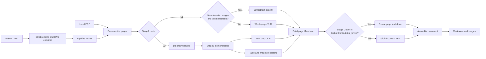

# Architecture

The local CLI reads a native YAML graph, validates it, and processes each input
PDF into Markdown and local artifacts. Start with the [quickstart](quickstart.md) for
execution steps; use [configuration](configuration.md) for the graph contract.

This diagram follows default, local_quickstart, managed and group/internal. Local uses Dolphin 1.5 and Paddle FastAPI with concurrency 2; the other profiles retain their provider transports. L1 pages with no raster images and extractable native text use the whole-page node’s internal pdfplumber gate with zero whole-page/global-context VLM calls. L2 remains on the layout path even without images. Confluence uses a separate document-scoped Markdown loader/upload graph.

Default, managed_endpoints and group_internal set Global Context `skip_levels: [1]`.
Its page node still runs; the shared service returns existing L1 content before
adapter construction, page rendering or a VLM request. Inherited page failures
take precedence and scheduler cancellation checks remain in effect. The decision
uses page `stage1_level`, independently of image content or Stage 2 element levels.
L2 and missing-level pages retain refinement; `[]` restores all eligible calls.
See [the setting](configuration.md#skipping-global-context-on-simple-pages).

Whole-page VLM uses a structured `output` response and passes only its Markdown
body downstream. Failed Global Context refinement preserves valid upstream
content and restored tables with an error marker and failure metadata.

## Code boundaries

`main.py` accepts a YAML path and calls the document pipeline. The
`core/engine/config/` models and compiler reject unknown fields, unregistered
nodes, incompatible DTO edges, invalid scopes, missing dependencies, cycles,
and an invalid `pipeline.output_node`. `core/engine/runtime/` runs the compiled
graph, expands page nodes after the split reveals the page count, and enforces
the graph's concurrency limits.

Nodes in `core/nodes/` implement `Node.run(context, value)` and return a
`NodeResult`. They coordinate processing in `core/services/`; adapters in
`core/adapters/` handle model, HTTP, Triton, and storage interfaces. DTOs in
`core/domain/` carry documents, pages, layout blocks, Markdown, and artifact
references. `core/interfaces/` defines node, adapter, registry, and observer
contracts. `core/observability/` reports CLI progress and records LLM usage;
optional Langfuse export is described under [privacy](privacy-and-data-handling.md).

## Graph and page scopes

Each node declares an `input` and `output` DTO label plus `is_list`. The
compiler recognizes `document_dto@v1`, `page_dto@v1`, `page_layout_dto@v1`,
`page_enriched_dto@v1`, `page_markdown_dto@v1`, and `none`. Scope determines
the required list shape:

| `execution_scope` | Input → output | Runtime behavior |
| --- | --- | --- |
| `fanout` | scalar → list | Runs once to split a document; `__START__` is its sole initial dependency. |
| `page` | list → list | One execution per page, with page results collected in order. |
| `fanin` | list → scalar | Runs once after required page results are available. |
| `document` | scalar → scalar | Runs once at document scope. |

Dependencies must match both DTO label and list cardinality. The configured
`output_node` must produce one `document_dto@v1`; the CLI writes that result as
`<input-stem>.md`. Default/local/managed/group PDF profiles use `global_context_assemble`.
See [outputs and failures](outputs-and-failures.md) for intermediate files and
page failure behavior.

## Validation

The diagram describes the supplied Dolphin-based default graph; choosing another
layout model requires an adapter with the same DTO contract. Compiler checks
validate structure, not provider compatibility or model accuracy. Run them for
the selected candidate as described in [development](development.md), and track
fresh-clone verification in the [release checklist](release-checklist.md).

LLM/VLM usage is recorded by default; costs are optional. Shipped profiles do not calculate prices. See [usage and pricing](llm-inference.md) to select operator rates with `pricing_file` or reprice saved records.

## Beta block context flow

Beta is under performance validation. After split → Stage 1 → layout → Stage 2 extraction, OCR → text restoration, table parse → table restoration, and image parse → image restoration run before merge. Whole-page and the restored branches feed merge → formatter (direct table rendering) → `block_context_assemble`. Context is limited to the current page image and the target block reference.
