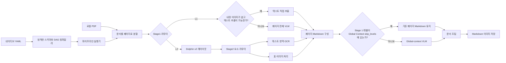

# 아키텍처

> 원문: [architecture.md](../architecture.md). 한국어 번역본입니다.

로컬 CLI는 네이티브 YAML 그래프를 읽고 검증한 뒤 각 PDF를 Markdown과 로컬 산출물로 처리합니다. 실행 순서는 [빠른 시작](quickstart.md), 그래프 계약은 [설정 안내](configuration.md)를 참고하세요.

위 그림은 default·local_quickstart·managed·group_internal의 공통 그래프입니다. local은 Dolphin 1.5·Paddle FastAPI와 동시성 2를 유지합니다. L1에서 실제 래스터 이미지가 없고 내장 텍스트를 얻으면 whole-page 내부 pdfplumber 경로를 사용하며 whole-page/global-context VLM 호출은 0회입니다. L2는 이미지가 없어도 layout 경로를 유지합니다. Confluence는 문서 범위 Markdown 로더·업로더의 별도 그래프입니다.

default·managed_endpoints·group_internal은 Global Context에 `skip_levels: [1]`을
지정합니다. 페이지 노드는 실행되지만 공통 서비스가 어댑터 생성·렌더링·VLM 요청 전에
기존 L1 내용을 반환합니다. 앞 단계 페이지 오류 처리가 우선이며 스케줄러 취소 검사는
유지됩니다. 이미지 내용이나 Stage 2 요소 레벨과 별개로 페이지 `stage1_level`만
검사합니다. L2·레벨 미상은 후처리를 유지하고 `[]`는 전체 대상 호출을 복원합니다.
[설정 안내](configuration.md#단순-페이지의-global-context-호출-생략)를 참고하세요.

Whole-page VLM은 구조화된 `output` 응답을 사용하며 Markdown 본문만 다음 단계에
전달합니다. Global Context 정제 실패 시 유효한 앞 단계 본문·복원된 표를 오류
표시와 실패 메타데이터와 함께 보존합니다.

## 코드 경계

`main.py`는 YAML 경로를 받아 문서 파이프라인을 호출합니다. `core/engine/config/`의 모델과 컴파일러는 알 수 없는 필드, 미등록 노드, 호환되지 않는 DTO 연결, 잘못된 실행 범위, 누락된 의존성, 순환, 잘못된 `pipeline.output_node`를 거부합니다. `core/engine/runtime/`은 컴파일된 그래프를 실행하고 분할 후 페이지 수에 맞춰 페이지 노드를 확장하며 동시성 제한을 적용합니다.

`core/nodes/`의 노드는 `Node.run(context, value)`을 구현하고 `NodeResult`를 반환합니다. 재사용 가능한 처리는 `core/services/`에, 모델·HTTP·Triton·저장소 인터페이스는 `core/adapters/`에 있습니다. `core/domain/`의 DTO는 문서, 페이지, 레이아웃 블록, Markdown, 산출물 참조를 전달합니다. `core/interfaces/`는 노드·어댑터·레지스트리·관찰자 계약을 정의합니다. `core/observability/`는 CLI 진행 상황을 보고하고 LLM 사용량을 기록합니다. 선택적 Langfuse 내보내기는 [데이터 처리](privacy-and-data-handling.md)를 참고하세요.

## 그래프와 페이지 실행 범위

각 노드는 `input`과 `output` DTO 레이블 및 `is_list`를 선언합니다. 컴파일러가 인식하는 레이블은 `document_dto@v1`, `page_dto@v1`, `page_layout_dto@v1`, `page_enriched_dto@v1`, `page_markdown_dto@v1`, `none`입니다.

| `execution_scope` | 입력 → 출력 | 실행 방식 |
| --- | --- | --- |
| `fanout` | 단일 → 목록 | 문서를 나누기 위해 한 번 실행. `__START__`가 유일한 시작 의존성입니다. |
| `page` | 목록 → 목록 | 페이지별로 실행하고 결과를 순서대로 모읍니다. |
| `fanin` | 목록 → 단일 | 필요한 페이지 결과가 모이면 한 번 실행합니다. |
| `document` | 단일 → 단일 | 문서 범위에서 한 번 실행합니다. |

의존성은 DTO 레이블과 목록 여부가 모두 일치해야 합니다. 설정된 `output_node`는 단일 `document_dto@v1`을 생성해야 하며 CLI는 이를 `<input-stem>.md`로 저장합니다. 네 PDF 프로필은 `global_context_assemble`을 사용합니다. 중간 파일과 페이지 오류는 [출력과 실패](outputs-and-failures.md)를 참고하세요.

## 검증

그림은 제공된 Dolphin 기반 기본 그래프를 설명합니다. 다른 레이아웃 모델은 같은 DTO
계약의 어댑터가 필요합니다. 컴파일 검사는 구조를 검증하며 제공자 호환성·모델 정확도를
증명하지 않습니다. 후보별 [개발 검사](development.md)를 실행하고 새 clone 검증은
[릴리스 점검표](release-checklist.md)에서 추적합니다.

LLM/VLM 사용량은 기본 기록되며 비용은 선택 사항입니다. 기본 프로필은 가격을 계산하지 않습니다. 실제 요율의 `pricing_file` 설정과 재계산은 [사용량·가격 안내](llm-inference.md)를 참고하세요.

## Beta 블록 문맥 흐름

성능 검증 중인 beta는 같은 split → Stage 1 → layout → Stage 2 추출 뒤에 OCR → text 복원, table parse → table 복원, image parse → image 복원을 배치합니다. whole-page와 세 복원 결과를 merge → formatter(표 직접 복구) → `block_context_assemble`로 조립합니다. 문맥은 현재 페이지 이미지와 해당 블록 reference로 제한됩니다. 다른 페이지의 전역 문맥 저장소를 사용하지 않습니다.
